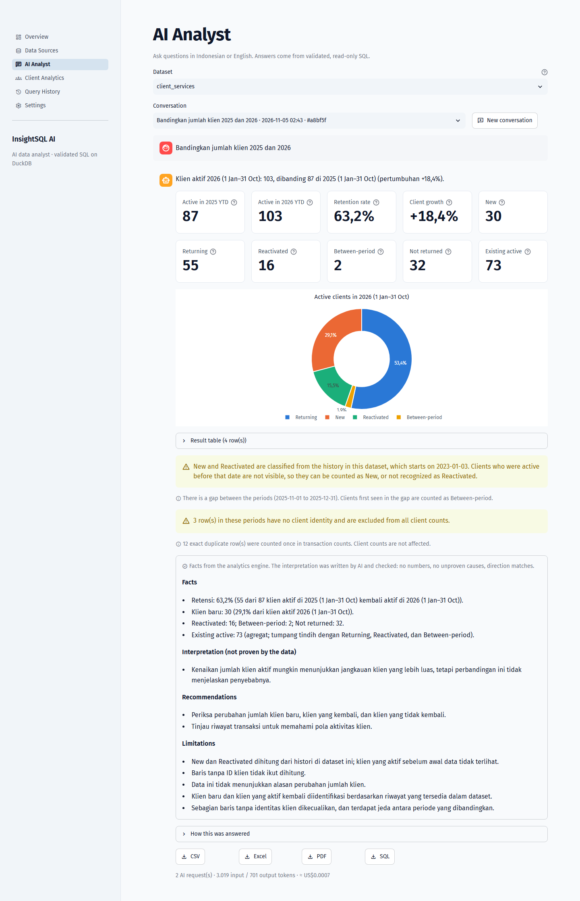
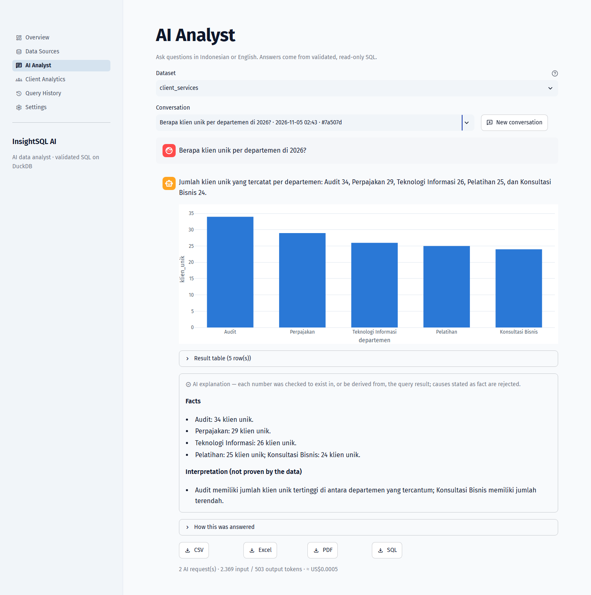
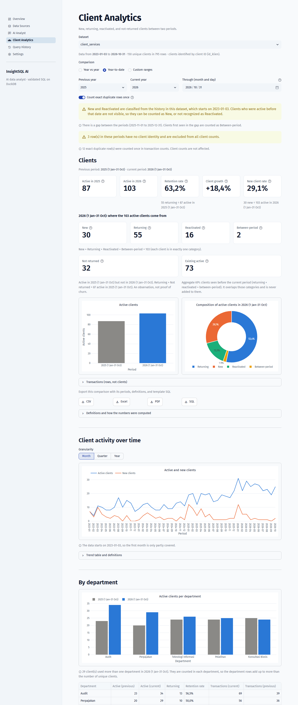
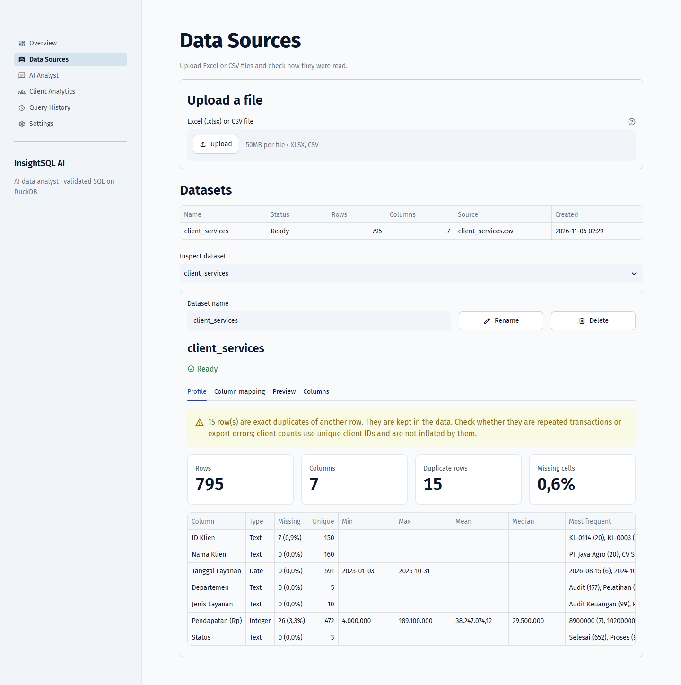
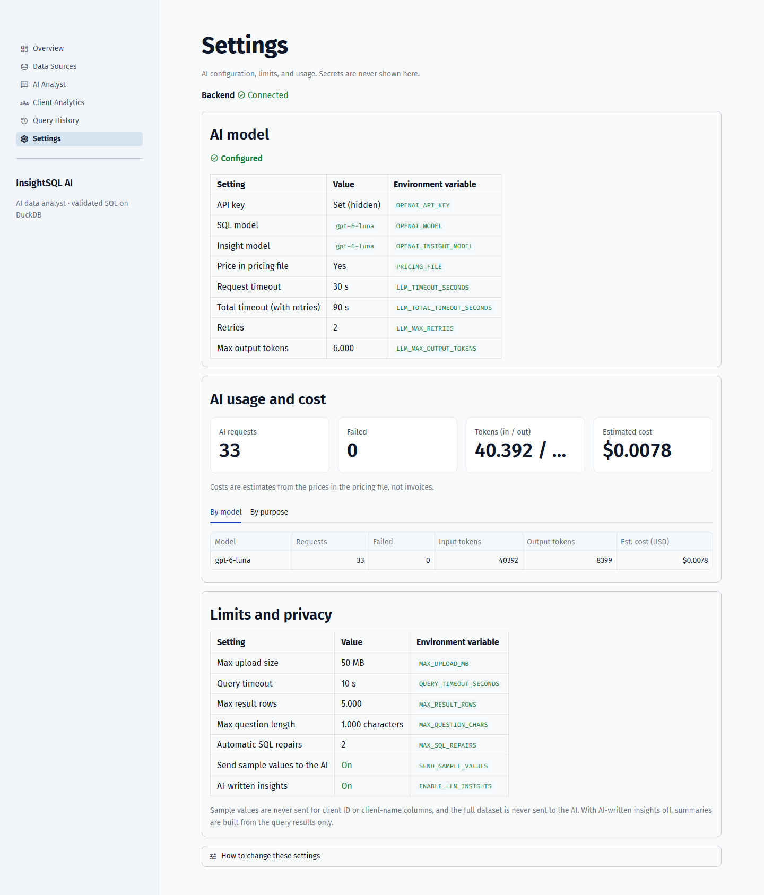
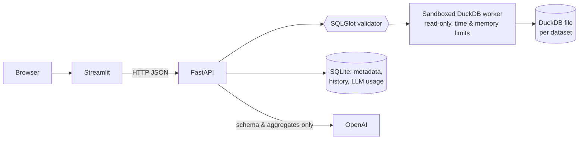

# InsightSQL AI

An AI data analyst for spreadsheets. Upload an Excel or CSV file, ask questions in
Indonesian or English, and get answers computed by SQL — with the query, a chart, an
explanation whose numbers are checked against the result, and exports. Client-retention
analytics (new, returning, reactivated, not-returned clients between two periods) come from
deterministic, tested SQL templates rather than from the model.

> The LLM interprets and writes queries. The database calculates. Python decides what is
> shown.

Streamlit · FastAPI · DuckDB · SQLite · SQLGlot · OpenAI Responses API (strict Structured
Outputs) · Python 3.13



## Features

- **Data Sources** — upload `.xlsx` (one sheet = one dataset) or `.csv`, also sheets laid
  out for people as downloaded from Google Sheets: **smart import** finds the header row
  below title rows, sets side tables aside, and skips trailing template rows (each step is
  reported; the header row can be corrected). Careful type inference (Indonesian `1.234,5`
  numbers, day-first dates, dates with month names such as `22/Jan/2025` or `17 Agustus
  2025`, IDs with leading zeros kept as text) where every interpretation is reported,
  never applied silently; a profile (missing
  values, duplicates, statistics); suggested column roles that the user confirms; rename and
  delete.
- **AI Analyst** — questions in Indonesian or English become a plan: read-only SQL, a
  retention comparison, a clarifying question, or a polite refusal. SQL is validated with
  SQLGlot and run in a sandboxed, read-only worker; failed queries are repaired up to twice.
  Answers show KPIs, an automatic chart, the SQL, assumptions, and an explanation whose
  numbers are verified against the result (otherwise a template summary is shown).
- **Client Analytics** — compare any two periods (year-to-date by default when the data
  ends mid-year): active, new, returning, reactivated, between-period, not-returned, and
  existing clients, retention and growth rates (N/A when undefined), trends, departments,
  client lists, and identity issues — no LLM involved.
- **Query History** — reopen, search, continue, or delete earlier conversations.
- **Exports** — CSV (formula injection neutralised), Excel (with a metadata sheet), PDF, and
  `.sql`.
- **Settings & cost** — model, limits, and per-request token usage and estimated cost; the
  API key stays on the server and is redacted from logs and errors.

| | |
|---|---|
|  |  |
|  |  |

Screenshots: the app running locally with `gpt-6-luna` (LLM: real, 2026-11-05) on the
synthetic sample data in `sample_data/`.

## Quick start

### Local

Requires Python 3.13.

```bash
python -m venv .venv
source .venv/bin/activate          # Windows PowerShell: .venv\Scripts\Activate.ps1
pip install -r requirements-dev.txt
cp .env.example .env               # Windows: copy .env.example .env
uvicorn backend.main:app --port 8000
```

Second terminal, same folder, venv active:

```bash
BACKEND_URL=http://localhost:8000 streamlit run frontend/app.py
# Windows PowerShell: $env:BACKEND_URL = "http://localhost:8000"; streamlit run frontend/app.py
```

Open http://localhost:8501 → **Data Sources** → upload `sample_data/client_services.csv` →
**Import** → tab **Column mapping** → **Confirm column mapping**. Client Analytics works
right away; the AI Analyst needs `OPENAI_API_KEY` and `OPENAI_MODEL` in `.env` (restart the
backend after editing it).

### Docker

```bash
cp .env.example .env               # optional
docker compose up --build -d       # frontend http://localhost:8501, API http://localhost:8000
```

The Compose setup has **not** been run yet (no Docker on the development machine); see
[DEPLOYMENT.md](docs/DEPLOYMENT.md) for what was verified instead.

## Configuration

Environment variables (or `.env`); the backend reads them at start.

| Variable | Default | Meaning |
|---|---|---|
| `OPENAI_API_KEY` | — | Needed for AI features. Server-side only. |
| `OPENAI_MODEL` | — | Model for SQL planning (nothing is hard-coded). |
| `OPENAI_INSIGHT_MODEL` | `OPENAI_MODEL` | Model for explanations (e.g. a cheaper one). |
| `LLM_TIMEOUT_SECONDS` | `30` | Per request. |
| `LLM_MAX_RETRIES` | `2` | Retries for timeouts, rate limits, 5xx only. |
| `LLM_TOTAL_TIMEOUT_SECONDS` | `90` | Cap including retries. |
| `LLM_MAX_OUTPUT_TOKENS` | `1500` | Output cap; use ~6000 for reasoning models (reasoning tokens count). |
| `DATA_DIR` | `data` | SQLite, DuckDB files, and raw uploads. |
| `MAX_UPLOAD_MB` | `50` | Upload limit. |
| `UPLOAD_CLEANUP_INTERVAL_MINUTES` | `60` | Raw uploads older than 24 h are removed this often. |
| `QUERY_TIMEOUT_SECONDS` | `10` | Per query; the worker is stopped after it. |
| `MAX_RESULT_ROWS` | `5000` | Rows returned per query. |
| `QUERY_THREADS` | `2` | DuckDB threads per query. |
| `QUERY_MEMORY_LIMIT` | `512MB` | DuckDB memory limit per query. |
| `QUERY_PROCESS_MEMORY_MB` | `1024` | Hard memory limit of the worker process (Linux). |
| `QUERY_ADDRESS_SPACE_MB` | `4096` | Worker address-space limit (Linux; 0 disables). |
| `MAX_RESULT_BYTES` | `20000000` | Size limit of a query result. |
| `MAX_SQL_REPAIRS` | `2` | Automatic repairs of a failing query (0–2). |
| `MAX_QUESTION_CHARS` | `1000` | Question length limit. |
| `SEND_SAMPLE_VALUES` | `true` | Send a few category values to the model (never IDs/names). |
| `ENABLE_LLM_INSIGHTS` | `true` | `false` = template explanations only (fewer tokens). |
| `PRICING_FILE` | `config/pricing.json` | Prices for cost estimates (USD per 1M tokens). |
| `LOG_LEVEL` | `INFO` | |
| `BACKEND_URL` | `http://localhost:8000` | Frontend only: where the API is. |

## How it works



1. The model sees the schema and aggregates, never the rows; identity and personal columns
   are never sampled ([PROMPTS.md](docs/PROMPTS.md)).
2. It returns a structured plan. SQL must pass an allowlist validator (one read-only
   `SELECT`, only the active table, no file/network/system functions) and runs in a separate
   process on a read-only connection with time, memory, and row limits.
3. Retention questions are routed to deterministic templates; the model only supplies the
   periods.
4. Explanations may only use numbers from the result; causal claims and wrong directions are
   rejected. Ratios with a zero denominator are N/A, never 0%.

Details: [ARCHITECTURE.md](docs/ARCHITECTURE.md) · storage: [DATABASE.md](docs/DATABASE.md).

## Evaluation

Measured on 2026-11-05 ([EVALUATION.md](docs/EVALUATION.md); raw results in
`eval/results/`). Text-to-SQL benchmark: 50 questions (10 PRD categories, 30 in Indonesian),
references written by hand or computed by the retention engine, `gpt-6-luna`, current SQL
prompt (v4), one run. Prompt v4 fixed a rule after two questions of this set failed with
v3 (95.0%, 38/40), so this score is **after an adjustment**; v2 scored 97.5% twice:

| Metric | Target (PRD) | Result |
|---|---|---|
| SQL execution success | ≥ 95% | 100% (30/30; 29/30 on the first attempt) |
| Query result accuracy | ≥ 90% | 100% (40/40) |
| Clarify / reject correctly | — | 100% (10/10) |
| Cost of the 50 questions | — | US$0.017 (average latency 6.3 s per question) |

These are one run of one model on a small synthetic set written by the same developer;
EVALUATION.md lists the wrong answers, the overlap with an earlier smoke test, and other
limitations. The 40/40 says nothing about stage-duration questions or unmapped datasets: the
set has none, and the evidence for those is two questions on one real file. Performance (300,000 rows, 2026-11-06): inspect 5.3 s, import 16 s; retention comparison,
trend, client list, and a group-by query 0.25–0.42 s each.

```bash
python -m pytest                   # ~1,050 tests, ~3 min; no API key or network needed
python -m pytest -m perf -s        # 300,000-row timing run
ruff check backend frontend tests eval scripts
python -m eval.run_eval --model "$OPENAI_MODEL"   # the benchmark: real API calls, real cost
```

## Project layout

```text
backend/    FastAPI app: api/, core/ (config, errors, redaction), repositories/ (SQLite),
            schemas/, services/ (ingest, profiling, validator, executor, analytics, LLM,
            insights, export)
frontend/   Streamlit app: app.py, views/ (six pages), components/, styles/
eval/       Benchmark questions, runner, re-grader, results
tests/      Unit, API, frontend (AppTest), integration, security, eval, perf
scripts/e2e Playwright scripts (real backend, scripted LLM)
docs/       PRD, architecture, database, prompts, deployment, evaluation, evidence
```

## Limitations

- Single-tenant, no login: put it behind authentication before sharing it
  ([DEPLOYMENT.md §5](docs/DEPLOYMENT.md#5-security-notes-for-a-shared-deployment)).
- One table per question (one sheet = one dataset); no joins across files.
- LLM answers can still be wrong while valid; the SQL and assumptions are always shown, and
  retention numbers never depend on the model.
- PDF exports use a built-in font (non-Latin characters become `?`) and contain no charts.
- The Docker setup is unverified; the memory watchdog of the query worker is Linux-only.
- Evaluated on one synthetic dataset and one model.

## Documentation

[PRD](docs/PRD.md) · [Architecture](docs/ARCHITECTURE.md) · [Database](docs/DATABASE.md) ·
[Prompts](docs/PROMPTS.md) · [Deployment](docs/DEPLOYMENT.md) ·
[Evaluation](docs/EVALUATION.md) · [Evidence log](docs/evidence/phase-log.md) ·
[Implementation plan](docs/plans/2026-11-04-insightsql-implementation-plan.md)
