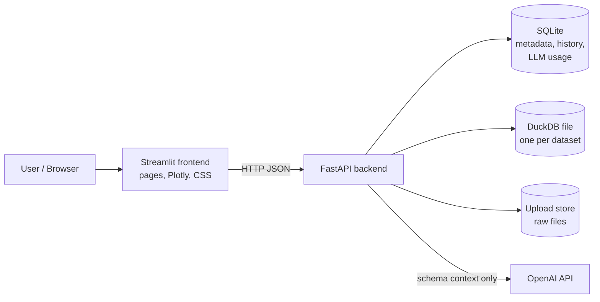
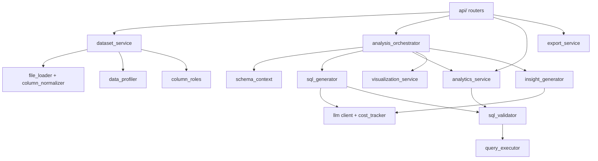
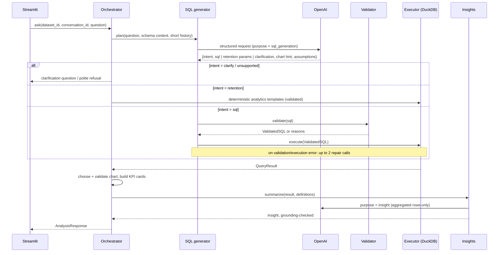

# InsightSQL AI — Architecture

Status: **Phase 1 design (approved plan pending).** This document describes the target
architecture. Sections are updated as each phase is implemented; anything not yet built
is marked *planned*.

Spec: [`PRD.md`](PRD.md) · Implementation plan:
[`plans/2026-11-04-insightsql-implementation-plan.md`](plans/2026-11-04-insightsql-implementation-plan.md)

---

## 1. Core principle

> The LLM interprets and writes queries. The database calculates. Python decides what is shown.

Every number a user sees comes from a DuckDB query result. The LLM never receives the full
dataset and never produces a number on its own; its insight text is checked against the
result before it is displayed (see §7.4).

## 2. System context

- The **frontend** holds no secrets and no business logic. It renders what the backend
  returns and validates chart specs before drawing them.
- The **backend** owns ingestion, profiling, validation, execution, analytics, LLM calls,
  cost tracking, and export.
- `OPENAI_API_KEY` exists only in the backend container's environment.

## 3. Backend components

| Module | Responsibility |
|---|---|
| `core/config.py` | Typed settings from environment (`pydantic-settings`). |
| `core/errors.py` | Domain exceptions mapped to HTTP errors with safe messages. |
| `repositories/*` | SQLite access: datasets, profiles, column mappings, conversations, analyses, LLM usage. |
| `services/file_loader.py` | Validate uploads, list Excel sheets, read CSV/XLSX into a DataFrame. |
| `services/column_normalizer.py` | Turn arbitrary headers (spaces, Indonesian, duplicates) into safe SQL identifiers; keep original labels. |
| `services/type_inference.py` | Detect numeric, date, and ID-like text columns without corrupting values (leading zeros, dd/mm dates). |
| `services/dataset_service.py` | Ingestion pipeline and dataset lifecycle; writes one DuckDB file per dataset. |
| `services/data_profiler.py` | Profile computed in DuckDB: nulls, duplicates, uniques, numeric stats, date ranges. |
| `services/column_roles.py` | Heuristic suggestions for Client ID / Name / Date / Department / Service / Revenue / Status. |
| `services/sql_validator.py` | SQLGlot-based allowlist validation; the only producer of `ValidatedSQL`. |
| `services/query_executor.py` | Executes `ValidatedSQL` on a read-only, sandboxed DuckDB connection with timeout and row cap. |
| `services/llm/*` | Provider-agnostic `LLMClient`, OpenAI implementation, prompt templates, cost tracking. |
| `services/schema_context.py` | Compact, sanitized, cached description of a dataset for the LLM. |
| `services/sql_generator.py` | Question → structured plan (SQL / retention / clarify / unsupported) with ≤ 2 repair attempts. |
| `services/analytics_service.py` | Deterministic client-retention metrics from parameterized SQL templates. |
| `services/visualization_service.py` | Rule-based chart selection from result shape; validates LLM chart hints. |
| `services/insight_generator.py` | Grounded narrative from results, with numeric grounding check and deterministic fallback. |
| `services/analysis_orchestrator.py` | One `ask()` pipeline used by the API. |
| `services/export_service.py` | CSV, Excel (with metadata sheet), PDF, and `.sql` downloads. |

## 4. Storage design

| Store | Technology | Contents | Why |
|---|---|---|---|
| Analytical data | DuckDB, `data/datasets/<dataset_id>.duckdb`, table `dataset` | One file per dataset (one Excel sheet = one dataset) | Isolation: a query can only see the one file it is opened on. Deleting a dataset deletes one file. |
| Metadata | SQLite, `data/app.db` (stdlib `sqlite3`, no ORM) | datasets, profiles (JSON), column mappings, conversations, messages/analyses, llm_usage | Small, transactional, zero-ops. |
| Raw uploads | `data/uploads/<upload_id>/<filename>` | Original file, kept for up to 24 h so several sheets of one workbook can be imported from a single upload; removed at startup once older than 24 h | Needed for two-step upload (inspect sheets → ingest chosen sheets). Periodic cleanup while running is a tracked follow-up (review M4). |

SQLite tables (full DDL lands in `docs/DATABASE.md` during Phase 8):

- `datasets(id, name, source_filename, sheet_name, status, error, row_count, column_count, duckdb_path, created_at)`
- `dataset_columns(dataset_id, position, name, original_name, logical_type)`
- `dataset_profiles(dataset_id, profile_json, created_at)`
- `column_mappings(dataset_id, mapping_json, confirmed, updated_at)`
- `conversations(id, dataset_id, title, created_at)`
- `analyses(id, conversation_id, dataset_id, question, status, sql, response_json, created_at)`
- `llm_usage(id, analysis_id, purpose, model, input_tokens, output_tokens, est_cost_usd, latency_ms, created_at)`

## 5. Main data flows

### 5.1 Upload and profiling

1. `POST /datasets/inspect` — validate extension, magic bytes (`PK` for xlsx), and size
   (`MAX_UPLOAD_MB`). Return `upload_id`, file type, and sheet names with row counts.
2. `POST /datasets` with `upload_id`, `sheet`, and the import options `number_format`
   (`auto` | `id` | `en`; CSV only, Excel always uses `plain`) and `date_order`
   (`auto` | `day_first` | `month_first`) — create a dataset record in status
   `processing` and run ingestion as a FastAPI background task.
3. Ingestion: read (CSV via pandas; XLSX via the `calamine` engine; header row read raw so
   duplicate headers keep their names) → normalize headers → infer types and record
   per-column notes → write DuckDB table → profile (stored; a profiling failure does not
   fail the import) → status `ready` (or `failed` with a safe error message).
4. The frontend polls `GET /datasets/{id}` until it is ready and then shows profile,
   column-mapping review, preview, and columns.
5. At startup, datasets left in `processing` by a restart are marked `failed`
   ("import was interrupted") and partial `*.tmp.duckdb` files are removed.

Type inference rules (`services/type_inference.py`, all covered by tests). **No value is
changed silently:** every interpretation the user might disagree with produces a
`ColumnNote` (`info` or `warning`) shown in the UI.

- Values are trimmed; blanks become missing.
- **Identifiers stay text:** leading-zero integers (`00123`) and integers with 16+ digits
  (e.g. NIK), also when written with spaces (`0812 3456 7890`, `3201 2345 6789 0123`), are
  never converted to numbers, so no digit is lost during import. Columns whose header
  names an identifier (`ID`, `Kode`, `No`, `Nomor`, `NIK`, `NPWP`, `Telepon`, `HP`,
  `Rekening`, …) stay text even when every value looks numeric (`identifier_kept_as_text`),
  so a non-numeric ID such as `KL-77` among `1001, 1002` is never lost.
- **Keep as text (import option):** the user can list any columns (by original header) to
  keep as text, for identifiers the header rule does not recognise.
  - Excel keeps at most 15 significant digits for *numeric* cells. A 16+ digit value from
    Excel gets a warning that its last digits may already be wrong in the file and
    **cannot be recovered** (cells formatted as Text are exact; the two cannot be told
    apart after reading). CSV files get a similar warning, since they may have been
    exported from such a sheet. Values in scientific notation (`9.17E+15`) get a warning
    that the digits were lost before the file was saved.
- A column converts to number/date only when ≥ 95% of its non-missing values parse.
  Values that do not parse become missing and are reported with examples
  (`unconverted_values`). Columns where 50–95% parse stay text with a `mixed_types` note.
- **Number format (CSV):** chosen at import. `id` = `1.234,5`, `en` = `1,234.5`,
  `auto` = one style detected per column. In `auto`, when every dot separates 3-digit
  groups (`1.000.000`, `1.234`) the dots are thousands separators (Indonesian
  convention); if no value proves it (only single groups such as `1.234`), the column
  gets an `ambiguous_number_format` warning naming the alternative format to re-import
  with. The same applies to `1,234` in English style. A group never starts with 0, so
  `0.125` is a decimal. Values written in another style than the column's are rejected
  and reported, never rewritten. Integers are converted exactly.
  - A column that mixes `1.500` and `1,500` single-group values stays text in `auto` mode
    (`mixed_number_format`); choosing `id` or `en` at import converts it.
  - Currency prefixes (`Rp`, `IDR`, `$`, `USD`) and the Indonesian `,-` suffix are removed
    and reported (`currency_removed`). A column with more than one currency stays text
    (`mixed_currency`). Spaces are only accepted as 3-digit group separators (`1 000 000`).
- Excel numbers are already canonical (`4.125` is 4.125), so Excel imports use `plain`.
- **Date order:** chosen at import. In `auto`, day-first if any first part > 12,
  month-first if any second part > 12; otherwise day-first with an
  `ambiguous_date_order` warning. A column proven to contain both orders gets a
  `mixed_date_order` warning. Impossible dates (`31/02/2026`) are reported.
- CSV encoding is chosen by decoding the whole file (UTF-8 → cp1252 → latin-1).

Profiling (`services/data_profiler.py`) runs one DuckDB aggregate scan: per column null
count/%, distinct count, top-5 values (truncated to 80 characters), min/max/mean/median/
sample std for numbers, min/max for dates; per dataset duplicate rows and missing cells.
Dataset notes: `duplicate_rows`, `missing_headers` (title row above the table),
`empty_column`, `no_date_column`.

### 5.1b Column roles and confirmation

`services/column_roles.py` suggests up to three candidates per role (client ID, client
name, transaction date, department, service type, revenue, status), each with a
confidence and human-readable reasons, using type gates (e.g. only date columns for the
transaction date), Indonesian/English header words, and profile statistics. It never
suggests a client identity without header evidence.

Suggestions are an **unsaved draft**. `PUT /datasets/{id}/column-mapping` stores the user's
choice with `confirmed=true`; the server validates that each column exists, has a
compatible type, and is used for one role only. Analytics (Phase 5) may only use a
confirmed mapping. Columns without any value cannot be confirmed for a role. The mapping
state also returns warnings (missing client IDs, client IDs lost in number conversion with
the "Keep as text" remedy, long or scientific-notation IDs, client IDs with several names,
name-only identity, history completeness, missing transaction dates) and the number of unique clients (confirmed
mappings only).

### 5.2 Natural-language question

Client-retention questions are **routed, not generated**: the LLM only extracts parameters
(periods, YTD), and the metrics come from tested SQL templates. This keeps the flagship
feature exact and cheap.

## 6. API contract (v1)

All responses are JSON unless noted. Errors use `{"error": {"code": str, "message": str}}`.

| Method & path | Request | Response |
|---|---|---|
| `GET /health` | — | `{status, llm_configured: bool, model: str \| null}` |
| `POST /datasets/inspect` | multipart `file` | `UploadInspection{upload_id, filename, file_type, sheets: [{name, row_count}]}` |
| `POST /datasets` | `{upload_id, sheet, name, number_format: auto\|id\|en, date_order: auto\|day_first\|month_first, text_columns: [original headers]}` | `DatasetRecord` (status `processing`) |
| `GET /datasets` | — | `DatasetRecord[]` |
| `GET /datasets/{id}` | — | `DatasetRecord` |
| `DELETE /datasets/{id}` | — | `204`; removes DuckDB file, metadata, history |
| `GET /datasets/{id}/preview` | `limit` ≤ 200 | `QueryResult` |
| `GET /datasets/{id}/profile` | — | `DatasetProfile` |
| `GET /datasets/{id}/columns` | — | `DatasetColumn[]` with original headers, types, and notes |
| `PATCH /datasets/{id}` | `{name}` | `DatasetRecord` |
| `GET /datasets/{id}/column-mapping` | — | `MappingState{mapping (confirmed) \| null, draft, suggestions, compatible_columns, warnings, unique_clients}` |
| `PUT /datasets/{id}/column-mapping` | `{client_id, client_name, transaction_date, department, service_type, revenue, status}` (each nullable) | `MappingState` (422 if a column is unknown, has an incompatible type, or is used twice) |
| `POST /datasets/{id}/client-analytics/compare` | `{previous: Period, current: Period, options}` | `RetentionResult` |
| `GET /datasets/{id}/client-analytics/clients` | `category`, periods | `QueryResult` (client list for drill-down/export) |
| `GET /datasets/{id}/client-analytics/trend` | `granularity=month\|quarter\|year` | `QueryResult` |
| `GET /datasets/{id}/client-analytics/identity-issues` | — | `IdentityReport` |
| `POST /analyses/ask` | `{dataset_id, conversation_id: str \| null, question}` | `AnalysisResponse` |
| `GET /conversations` | `dataset_id` | `ConversationSummary[]` |
| `GET /conversations/{id}` | — | `Conversation` with analyses |
| `DELETE /conversations/{id}` | — | `204` |
| `GET /analyses/{id}/export` | `format=csv\|xlsx\|pdf\|sql` | file download |
| `GET /usage/summary` | — | totals overall, by model, by purpose; estimated cost and the number of requests without an estimate |
| `GET /usage/requests` | `limit` ≤ 500 | latest `UsageRecord`s (no prompts, no answers) |
| `GET /settings` | — | non-secret runtime settings |

Key response models (Pydantic, in `backend/schemas/`):

- `QueryResult{columns: list[str], rows: list[list[Any]], row_count: int, truncated: bool, elapsed_ms: float}`
- `Period{label: str, start: date, end: date}` — `end` is **exclusive**.
- `RetentionResult` — counts, rates (`float | None`; `None` renders as **N/A**), warnings,
  definitions, executed SQL.
- `ChartSpec{type: bar|line|area|pie|donut|hbar|grouped_bar|kpi, x: str|None, y: list[str], color: str|None, title: str}`
- `AnalysisResponse{analysis_id, status: answered|clarification|unsupported|error, answer, kpis, chart, table, sql, explanation, assumptions, insight, warnings, usage}`

## 7. Security model

### 7.1 SQL validation (`sql_validator`) — implemented in Phase 4

The pipeline is **question → LLM plan → `validate_sql` → `QueryExecutor` → `QueryResult`**.
The LLM never executes anything; the system prompt is one layer, not the security boundary.

`validate_sql(sql, TableSchema)` parses with SQLGlot (`dialect="duckdb"`) and returns a
`ValidatedSQL` only when all rules hold (each failure reason starts with its rule name):

| Rule | Rejects |
|---|---|
| `empty`, `too_long` (> 20,000 chars), `parse_error` | malformed input |
| `multiple_statements` | more than one statement (a comment-only trailing `;` is ignored) |
| `not_select` | any root other than `SELECT` or a set operation — an **allowlist**, so every write, DDL, session, and utility statement is rejected, including ones SQLGlot only knows as generic commands (`LOAD`, `CALL`) |
| `forbidden_table` | anything but the active dataset's table `dataset` and CTEs of the same query; schema/catalog-qualified names; file paths in `FROM` |
| `forbidden_function` | file/network readers (`read_*`, `glob`, `parquet_*`, …), SQL-executing functions (`query`, `query_table`, `json_execute*`), environment/config/catalog functions (`getenv`, `current_setting`, `duckdb_*`, `pragma_*`), and unbounded generators (`range`, `generate_series`, `repeat`) — in any position, including table functions and CTEs |
| `recursive_cte`, `cartesian_join` (CROSS, comma joins, `ON TRUE`), `too_many_joins` (> 5) | resource exhaustion |
| `unknown_column` | columns that do not exist in the active dataset (SQLGlot `qualify` against the schema) |

`ValidatedSQL` is immutable and can only be created by `validate_sql` (a private token);
`QueryExecutor.execute` raises `TypeError` for anything else. The attack corpus
(`tests/security/attack_corpus.yaml`, 61 cases incl. syntactically valid bypass attempts)
and 20 accepted analytical queries are run on every test run.

### 7.2 Execution sandbox (`query_executor`) — defense in depth

- Opens the dataset file with `read_only=True`, `enable_external_access=false`, extension
  autoload/autoinstall and community extensions disabled, then `SET lock_configuration=true`.
  Tests run dangerous SQL that **bypasses the validator** (file reads, `COPY`, `ATTACH`,
  `INSTALL`, `CREATE`, `DELETE`, `SET`) and show the sandbox blocks each one.
- `QUERY_THREADS` (default 2) and `QUERY_MEMORY_LIMIT` (default 512MB) per query.
- Timeout: a watchdog calls `connection.interrupt()` after `QUERY_TIMEOUT_SECONDS`.
- Row cap: `SELECT * FROM (<sql>) AS result_set LIMIT MAX_RESULT_ROWS + 1` sets `truncated`
  (inner `ORDER BY` order is preserved; tested).
- Errors are sanitized before they reach users, logs, or the LLM: quoted values, file paths,
  long numbers, and the echoed query are removed (DuckDB errors otherwise quote cell values,
  e.g. `Could not convert string 'KL-77'`).

### 7.3 Prompt-injection and privacy — implemented in Phase 4

- Sent to the LLM (`services/schema_context.py`): table name and row count; per column the SQL
  name, original header, type, confirmed role, missing %, distinct count, and aggregates
  (min/max/mean, date range); definitions derived from the confirmed mapping; up to five
  example values **only** for low-cardinality (≤ 30), non-sensitive text categories.
- Never sent: individual records or numbers; any value or statistic of identity columns
  (confirmed client ID/name) or of columns whose header suggests personal data (NIK, NPWP,
  KTP, phone, e-mail, address, name, birth date, account/rekening, salary, …) or whose values
  look like e-mail addresses or phone/long numbers; values of identifier/code columns.
  `SEND_SAMPLE_VALUES=false` withholds every example.
- Headers and values come from the user's file: they appear only inside a JSON-encoded
  `<data>` block that the prompt marks as untrusted; the question is wrapped in `<question>`.
- Conversation history sent to the model contains earlier questions and SQL, never results.
- Prompts, questions, and responses are never logged or stored in usage records; provider
  error bodies (which can echo the prompt) are never put in messages or logs.
- Even if the model is manipulated, its output can only be a validated, read-only query on
  the active dataset, executed in the sandbox.

### 7.4 Grounded insights

The insight model receives only the (already aggregated, capped) result rows plus metric
definitions. Before display, every number in its text is checked against the result values
and derived percentages. If any number is ungrounded, the system shows a deterministic,
template-based summary instead and logs the event.

## 8. Client-retention definitions

Every category counts **unique client identities** (distinct client IDs), never
transactions; transaction counts are reported separately.

For a client identity `c` and a period `P = [start, end)`, `c` is **active in P** if it has at
least one transaction with a date in `P`. `first_seen(c)` is its earliest transaction date in
the whole dataset. With `previous` before `current` (non-overlapping, enforced):

| Metric | Definition |
|---|---|
| Active (previous / current) | distinct clients active in that period |
| **New** | active in current **and** `first_seen` within current |
| **Returning** | active in previous **and** current |
| **Reactivated** | active in current, **not** active in previous, and `first_seen` **before previous start** (was a client before, skipped the previous period, came back) |
| **Between-period** | active in current, **not** active in previous, and `first_seen` in the gap between previous end and current start. Always 0 when the periods are adjacent (e.g. 2025 vs 2026). |
| **Not returned** | active in previous **and not** active in current (an observation, not proof of churn) |
| Existing active (aggregate KPI) | active in current **and** `first_seen` before current start = returning + reactivated + between-period |
| Transactions | rows in the period after exclusions below |
| Repeat transactions | transactions − active clients in the period; also reported: clients with ≥ 2 transactions |
| Retention rate | returning / previous active |
| New client rate | new / current active |
| Client growth rate | (current active − previous active) / previous active |

**No double counting.** The categories form two exact partitions, which tests check on
every fixture and on the sample dataset:

- Current period: `current active = new + returning + reactivated + between-period`
- Previous period: `previous active = returning + not returned`

*Existing active* is an aggregate that **overlaps** returning, reactivated, and
between-period. It is shown as its own KPI and is never added to or stacked with those
categories in charts, totals, or exports. The current-period breakdown chart uses only the
partition categories.

Rules:

- Rates with a zero denominator are `None` → shown as **N/A**.
- `previous` must end on or before `current` starts (no overlap); otherwise the request is rejected.
- Identity = client ID column (trimmed, kept as text). If no ID is mapped, the normalized
  client name is used (trim, collapse spaces, case-fold) with a visible warning.
- Rows with missing identity are excluded from client metrics and counted in `excluded_missing_id_rows`.
- Exact duplicate rows are excluded from transaction counts by default (`dedupe_exact_duplicates=true`) and counted.
- Warnings:
  - **History completeness (always shown):** New and Reactivated are classified from the
    history in the dataset. Clients active before the first date in the data are invisible,
    so they can be counted as New, or not recognized as Reactivated.
  - **History starts late:** if the data begins on or after the previous period start, "new" may be overstated.
  - **Incomplete period:** if the current period ends after the last date in the data, suggest a YTD comparison.
  - **Identity inconsistency:** IDs with several names, or names with several IDs.
- YTD comparison: both periods are cut to the same month/day as `through` (Feb 29 is clamped to Feb 28 in non-leap years).

## 9. LLM integration and cost — implemented in Phase 4

- `OPENAI_API_KEY`, `OPENAI_MODEL` (required for AI features) and `OPENAI_INSIGHT_MODEL`
  (optional). No model ID is hard-coded; the key exists only in the backend environment
  (`SecretStr`, never logged or returned by the API).
- `OpenAIClient` uses the Responses API with **strict Structured Outputs** (`responses.parse`
  with a Pydantic schema) and `store=False`. The SDK's own retries are disabled; the client
  retries timeouts, connection errors, HTTP 429, and 5xx at most `LLM_MAX_RETRIES` times
  (default 2) with exponential backoff, honouring `Retry-After` up to 20 s. Other errors are not
  retried. Timeouts: `LLM_TIMEOUT_SECONDS` per request. Output cap: `LLM_MAX_OUTPUT_TOKENS`.
  (The planned JSON-mode fallback for models without Structured Outputs was not built: such a
  model returns an error that is reported clearly.)
- `LLMGateway` is the only way the app calls a model. Every request — success or failure — is
  stored in `llm_requests`: id, timestamp, purpose (`sql_generation`, `sql_repair`, later
  `insight`), dataset and analysis ids, model, status, attempts (retries = attempts − 1), input,
  output, and cached tokens, estimated cost, `cost_status`, latency, error code/message, and the
  prompt version. `GET /usage/requests` and `GET /usage/summary` expose them.
- Prices live only in `config/pricing.json` (USD per 1M input, cached-input, and output
  tokens). Cost = (input − cached) × input price + cached × cached price (input price if no
  cached price) + output × output price. Without usage or price the cost is `null` with
  `cost_status` `unavailable_no_usage` / `unavailable_no_price`; summaries report how many
  requests have no estimate instead of treating them as zero cost.
- SQL generation: up to `MAX_SQL_REPAIRS` (default 2, maximum 2) repair calls, each given
  the sanitized error. Clarification, unsupported, and retention intents are returned without
  executing anything. After the limit the user gets a clear explanation (`sql_generation_failed`).
- Calls avoided: profiling, role suggestion, chart choice, and retention math are pure
  Python/SQL. Schema context is cached per dataset/profile/confirmed-mapping state.
- Without an API key the app still works for upload, profiling, column mapping, client
  analytics, history, and export; AI calls raise `llm_not_configured` without contacting anyone.
- **Status of the real API:** in the development environment `api.openai.com` is blocked and no
  key is configured. All LLM tests use a fake client or a fake HTTP transport; they verify our
  code, not the provider or model quality. The real integration and the evaluation benchmark
  have **not** been run yet.

## 10. Key decisions and assumptions

| # | Decision | Reason / trade-off |
|---|---|---|
| D1 | Repo root is the project root (no extra `insightsql-ai/` folder). | The repository already is the project. |
| D2 | Streamlit + FastAPI as two processes. | PRD goal: demonstrate backend engineering; costs one more service. |
| D3 | One DuckDB file per dataset; SQLite for metadata. | Strong isolation and simple deletion vs. one shared warehouse. |
| D4 | Retention metrics from deterministic templates; the LLM only routes and extracts parameters. | Accuracy and cost for the flagship feature. |
| D5 | Rule-based chart selection; the LLM hint is advisory and validated. | Deterministic, no extra tokens. |
| D6 | Heuristic column-role suggestions (no LLM) with user confirmation. | Free and predictable; LLM refinement is a possible later addition. |
| D7 | Single-tenant MVP (no login); isolation is per dataset. | Auth is out of PRD scope; documented as a future step. |
| D8 | PDF via `fpdf2` with tables and text; chart images are not embedded in v1. | Embedding Plotly images needs Kaleido + Chrome in the container. |
| D9 | Python 3.13, dependencies pinned in `requirements.txt`. | Matches the dev environment and the Docker image. |
| D10 | Code, docs, and UI copy in English; the app answers in the user's language (ID/EN). | Portfolio audience; the PRD requires bilingual Q&A. |
| D11 | Excel read with the `calamine` engine. | Much faster than openpyxl for large sheets. |

## 11. Risks

| Risk | Impact | Mitigation |
|---|---|---|
| OpenAI API blocked in the current dev environment; no API key yet. | Real LLM features and the benchmark cannot run here. | Provider-agnostic `LLMClient`; unit tests use a fake client; the benchmark is run once the network/key is available. No made-up benchmark numbers. |
| LLM writes wrong but valid SQL. | Plausible but wrong answers. | Retention via templates; assumptions and SQL shown; evaluation benchmark with ground truth. |
| Ambiguous dates (dd/mm vs mm/dd), IDs with leading zeros. | Silent data corruption. | Conservative type inference; IDs kept as text; dayfirst detection; tests. |
| Incomplete current year (data through Oct 2026). | Misleading decline. | Incomplete-period warning + YTD option. |
| Large Excel files (100k+ rows). | Slow upload, blocked UI. | Background ingestion, calamine engine, performance test in Phase 7. |
| Prompt injection via cell values. | Model manipulation. | Data blocks, no samples for identity columns, validator + sandbox. |
| Docker daemon not running in the dev container. | Compose cannot be verified here. | Try starting `dockerd` in Phase 8; otherwise report it as unverified. |
