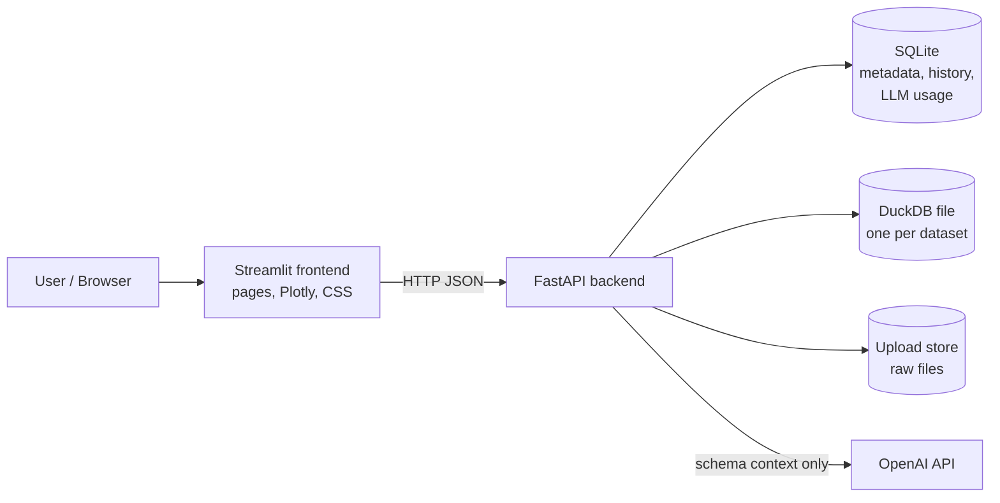
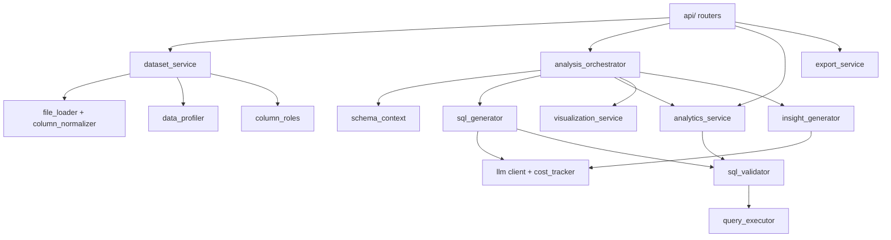
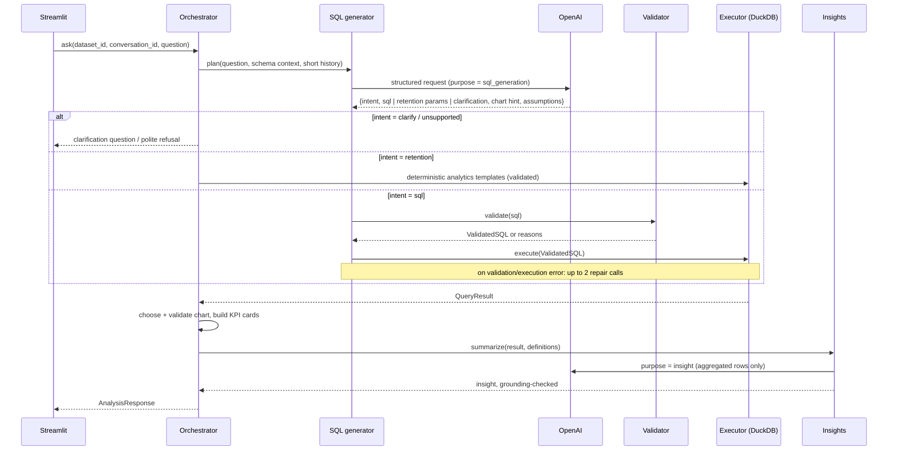

# InsightSQL AI — Architecture

Status: **Phase 1 design (approved plan pending).** This document describes the target
architecture. Sections are updated as each phase is implemented; anything not yet built
is marked *planned*.

Spec: [`PRD.md`](PRD.md) · Implementation plan:
[`plans/2026-11-04-insightsql-implementation-plan.md`](plans/2026-11-04-insightsql-implementation-plan.md)

---

## 1. Core principle

> The LLM interprets and writes queries. The database calculates. Python decides what is shown.

Every number a user sees comes from a DuckDB query result. The LLM never receives the full
dataset and never produces a number on its own; its insight text is checked against the
result before it is displayed (see §7.4).

## 2. System context

- The **frontend** holds no secrets and no business logic. It renders what the backend
  returns and validates chart specs before drawing them.
- The **backend** owns ingestion, profiling, validation, execution, analytics, LLM calls,
  cost tracking, and export.
- `OPENAI_API_KEY` exists only in the backend container's environment.

## 3. Backend components

| Module | Responsibility |
|---|---|
| `core/config.py` | Typed settings from environment (`pydantic-settings`). |
| `core/errors.py` | Domain exceptions mapped to HTTP errors with safe messages. |
| `repositories/*` | SQLite access: datasets, profiles, column mappings, conversations, analyses, LLM usage. |
| `services/file_loader.py` | Validate uploads, list Excel sheets, read CSV/XLSX into a DataFrame. |
| `services/column_normalizer.py` | Turn arbitrary headers (spaces, Indonesian, duplicates) into safe SQL identifiers; keep original labels. |
| `services/type_inference.py` | Detect numeric, date, and ID-like text columns without corrupting values (leading zeros, dd/mm dates). |
| `services/dataset_service.py` | Ingestion pipeline and dataset lifecycle; writes one DuckDB file per dataset. |
| `services/data_profiler.py` | Profile computed in DuckDB: nulls, duplicates, uniques, numeric stats, date ranges. |
| `services/column_roles.py` | Heuristic suggestions for Client ID / Name / Date / Department / Service / Revenue / Status. |
| `services/sql_validator.py` | SQLGlot-based allowlist validation; the only producer of `ValidatedSQL`. |
| `services/query_executor.py` | Executes `ValidatedSQL` on a read-only, sandboxed DuckDB connection with timeout and row cap. |
| `services/llm/*` | Provider-agnostic `LLMClient`, OpenAI implementation, prompt templates, cost tracking. |
| `services/schema_context.py` | Compact, sanitized, cached description of a dataset for the LLM. |
| `services/sql_generator.py` | Question → structured plan (SQL / retention / clarify / unsupported) with ≤ 2 repair attempts. |
| `services/analytics_service.py` | Deterministic client-retention metrics from parameterized SQL templates. |
| `services/visualization_service.py` | Rule-based chart selection from result shape; validates LLM chart hints. |
| `services/insight_generator.py` | Grounded narrative from results, with numeric grounding check and deterministic fallback. |
| `services/analysis_orchestrator.py` | One `ask()` pipeline used by the API. |
| `services/export_service.py` | CSV, Excel (with metadata sheet), PDF, and `.sql` downloads. |

## 4. Storage design

| Store | Technology | Contents | Why |
|---|---|---|---|
| Analytical data | DuckDB, `data/datasets/<dataset_id>.duckdb`, table `dataset` | One file per dataset (one Excel sheet = one dataset) | Isolation: a query can only see the one file it is opened on. Deleting a dataset deletes one file. |
| Metadata | SQLite, `data/app.db` (stdlib `sqlite3`, no ORM) | datasets, profiles (JSON), column mappings, conversations, messages/analyses, llm_usage | Small, transactional, zero-ops. |
| Raw uploads | `data/uploads/<upload_id>/<filename>` | Original file until ingestion finishes, then deleted | Needed for two-step upload (inspect sheets → ingest chosen sheet). |

SQLite tables (full DDL lands in `docs/DATABASE.md` during Phase 8):

- `datasets(id, name, source_filename, sheet_name, status, error, row_count, column_count, duckdb_path, created_at)`
- `dataset_columns(dataset_id, position, name, original_name, logical_type)`
- `dataset_profiles(dataset_id, profile_json, created_at)`
- `column_mappings(dataset_id, mapping_json, confirmed, updated_at)`
- `conversations(id, dataset_id, title, created_at)`
- `analyses(id, conversation_id, dataset_id, question, status, sql, response_json, created_at)`
- `llm_usage(id, analysis_id, purpose, model, input_tokens, output_tokens, est_cost_usd, latency_ms, created_at)`

## 5. Main data flows

### 5.1 Upload and profiling

1. `POST /datasets/inspect` — validate extension, magic bytes (`PK` for xlsx), and size
   (`MAX_UPLOAD_MB`). Return `upload_id`, file type, and sheet names with row counts.
2. `POST /datasets` with `upload_id` + `sheet` — create a dataset record in status
   `processing` and run ingestion as a FastAPI background task.
3. Ingestion: read (CSV via pandas; XLSX via the `calamine` engine for speed) → normalize
   headers → infer types → write DuckDB table → profile → suggest column roles → status
   `ready` (or `failed` with a safe error message).
4. The frontend polls `GET /datasets/{id}` until it is ready and then shows preview + profile.

### 5.2 Natural-language question

Client-retention questions are **routed, not generated**: the LLM only extracts parameters
(periods, YTD), and the metrics come from tested SQL templates. This keeps the flagship
feature exact and cheap.

## 6. API contract (v1)

All responses are JSON unless noted. Errors use `{"error": {"code": str, "message": str}}`.

| Method & path | Request | Response |
|---|---|---|
| `GET /health` | — | `{status, llm_configured: bool, model: str \| null}` |
| `POST /datasets/inspect` | multipart `file` | `UploadInspection{upload_id, filename, file_type, sheets: [{name, row_count}]}` |
| `POST /datasets` | `{upload_id, sheet: str \| null, name: str \| null}` | `DatasetRecord` (status `processing`) |
| `GET /datasets` | — | `DatasetRecord[]` |
| `GET /datasets/{id}` | — | `DatasetRecord` |
| `DELETE /datasets/{id}` | — | `204`; removes DuckDB file, metadata, history |
| `GET /datasets/{id}/preview` | `limit` ≤ 200 | `QueryResult` |
| `GET /datasets/{id}/profile` | — | `DatasetProfile` |
| `GET /datasets/{id}/column-mapping` | — | `{mapping: ColumnMapping, suggestions: RoleSuggestion[]}` |
| `PUT /datasets/{id}/column-mapping` | `ColumnMapping` | `ColumnMapping` (columns must exist; date column must be date-typed) |
| `POST /datasets/{id}/client-analytics/compare` | `{previous: Period, current: Period, options}` | `RetentionResult` |
| `GET /datasets/{id}/client-analytics/clients` | `category`, periods | `QueryResult` (client list for drill-down/export) |
| `GET /datasets/{id}/client-analytics/trend` | `granularity=month\|quarter\|year` | `QueryResult` |
| `GET /datasets/{id}/client-analytics/identity-issues` | — | `IdentityReport` |
| `POST /analyses/ask` | `{dataset_id, conversation_id: str \| null, question}` | `AnalysisResponse` |
| `GET /conversations` | `dataset_id` | `ConversationSummary[]` |
| `GET /conversations/{id}` | — | `Conversation` with analyses |
| `DELETE /conversations/{id}` | — | `204` |
| `GET /analyses/{id}/export` | `format=csv\|xlsx\|pdf\|sql` | file download |
| `GET /usage/summary` | — | totals by model and purpose, estimated cost |
| `GET /settings` | — | non-secret runtime settings |

Key response models (Pydantic, in `backend/schemas/`):

- `QueryResult{columns: list[str], rows: list[list[Any]], row_count: int, truncated: bool, elapsed_ms: float}`
- `Period{label: str, start: date, end: date}` — `end` is **exclusive**.
- `RetentionResult` — counts, rates (`float | None`; `None` renders as **N/A**), warnings,
  definitions, executed SQL.
- `ChartSpec{type: bar|line|area|pie|donut|hbar|grouped_bar|kpi, x: str|None, y: list[str], color: str|None, title: str}`
- `AnalysisResponse{analysis_id, status: answered|clarification|unsupported|error, answer, kpis, chart, table, sql, explanation, assumptions, insight, warnings, usage}`

## 7. Security model

### 7.1 SQL validation (`sql_validator`)

Parse with SQLGlot (`dialect="duckdb"`). Reject unless **all** hold:

1. Exactly one statement; the root is `SELECT` or a set operation (`UNION`/`INTERSECT`/`EXCEPT`), optionally with `WITH` CTEs.
2. No node of a write/DDL/session type anywhere in the tree (insert, update, delete, merge, create, drop, alter, copy, attach/detach, install/load, pragma, set/reset, use, transaction, export/import, call, generic commands).
3. Every table reference is either the dataset table `dataset` or a CTE defined in the same query; no schema/catalog qualifiers; no string/file paths in `FROM`.
4. No table functions or file/system functions (e.g. `read_csv*`, `read_parquet`, `read_json*`, `read_text`, `read_blob`, `glob`, `query`, `query_table`, `getenv`, `duckdb_*`, `pragma_*`).
5. All column references resolve against the dataset schema (SQLGlot `qualify` with the schema).

Only the validator can construct a `ValidatedSQL` object, and the executor accepts nothing else.
Deterministic analytics SQL goes through the same validator.

### 7.2 Execution sandbox (`query_executor`) — defense in depth

- Opens the dataset file with `read_only=True` and `enable_external_access=false`, extension
  autoload/autoinstall disabled, then `lock_configuration=true`.
- Limits `threads` and `memory_limit`.
- Timeout: a watchdog calls `connection.interrupt()` after `QUERY_TIMEOUT_SECONDS`.
- Row cap: wraps the query as `SELECT * FROM (<sql>) LIMIT <MAX_RESULT_ROWS + 1>` and sets `truncated`.

### 7.3 Prompt-injection and privacy

- Dataset content is untrusted data. Sample values are short, deduplicated, length-capped,
  and passed inside a clearly delimited data block. The system prompt tells the model to
  treat them as data.
- **No sample values** are sent for columns mapped or detected as client ID, client name, or
  identifier-like (email, phone). Only type and cardinality are sent. `SEND_SAMPLE_VALUES=false`
  disables samples entirely.
- Even if the model is manipulated, its output can only be a validated read-only query on
  one dataset.

### 7.4 Grounded insights

The insight model receives only the (already aggregated, capped) result rows plus metric
definitions. Before display, every number in its text is checked against the result values
and derived percentages. If any number is ungrounded, the system shows a deterministic,
template-based summary instead and logs the event.

## 8. Client-retention definitions

For a client identity `c` and a period `P = [start, end)`, `c` is **active in P** if it has at
least one transaction with a date in `P`. `first_seen(c)` is its earliest transaction date in
the whole dataset. With `previous` before `current` (non-overlapping, enforced):

| Metric | Definition |
|---|---|
| Active (previous / current) | distinct clients active in that period |
| Returning | active in previous **and** current |
| New | active in current **and** `first_seen` within current |
| Existing active | active in current **and** `first_seen` before current start (= current active − new) |
| Not returned | active in previous **and not** active in current (an observation, not proof of churn) |
| Transactions | rows in the period after exclusions below |
| Repeat transactions | transactions − active clients in the period; also reported: clients with ≥ 2 transactions |
| Retention rate | returning / previous active |
| New client rate | new / current active |
| Client growth rate | (current active − previous active) / previous active |

Rules:

- Rates with a zero denominator are `None` → shown as **N/A**.
- Invariants checked in tests: new + existing active = current active; returning + not returned = previous active.
- Identity = client ID column (trimmed, kept as text). If no ID is mapped, the normalized
  client name is used (trim, collapse spaces, case-fold) with a visible warning.
- Rows with missing identity are excluded from client metrics and counted in `excluded_missing_id_rows`.
- Exact duplicate rows are excluded from transaction counts by default (`dedupe_exact_duplicates=true`) and counted.
- Warnings:
  - **History starts late:** if the data begins on or after the previous period start, "new" may be overstated.
  - **Incomplete period:** if the current period ends after the last date in the data, suggest a YTD comparison.
  - **Identity inconsistency:** IDs with several names, or names with several IDs.
- YTD comparison: both periods are cut to the same month/day as `through` (Feb 29 is clamped to Feb 28 in non-leap years).

## 9. LLM integration and cost

- `OPENAI_API_KEY`, `OPENAI_MODEL` (required for AI features) and `OPENAI_INSIGHT_MODEL`
  (optional, defaults to `OPENAI_MODEL`, allowing a cheaper model for summaries). No model ID
  is hard-coded.
- Structured Outputs via the OpenAI Python SDK with a Pydantic schema. If the configured
  model does not support them, the client falls back to JSON mode + Pydantic validation.
- Every call is logged in `llm_usage` with purpose (`sql_generation`, `sql_repair`, `insight`),
  model, tokens, latency, and estimated cost. Prices come from `config/pricing.json`. An unknown
  model gets `est_cost_usd = null`, never a guess.
- Calls avoided: profiling, role suggestion, chart choice, and retention math are pure
  Python/SQL. Schema context is cached per dataset version. Insight generation can be turned
  off (`ENABLE_LLM_INSIGHTS=false`) to fall back to deterministic summaries.
- Without an API key the app still works for upload, profiling, column mapping, client
  analytics, history, and export. The AI Analyst explains how to configure the key.

## 10. Key decisions and assumptions

| # | Decision | Reason / trade-off |
|---|---|---|
| D1 | Repo root is the project root (no extra `insightsql-ai/` folder). | The repository already is the project. |
| D2 | Streamlit + FastAPI as two processes. | PRD goal: demonstrate backend engineering; costs one more service. |
| D3 | One DuckDB file per dataset; SQLite for metadata. | Strong isolation and simple deletion vs. one shared warehouse. |
| D4 | Retention metrics from deterministic templates; the LLM only routes and extracts parameters. | Accuracy and cost for the flagship feature. |
| D5 | Rule-based chart selection; the LLM hint is advisory and validated. | Deterministic, no extra tokens. |
| D6 | Heuristic column-role suggestions (no LLM) with user confirmation. | Free and predictable; LLM refinement is a possible later addition. |
| D7 | Single-tenant MVP (no login); isolation is per dataset. | Auth is out of PRD scope; documented as a future step. |
| D8 | PDF via `fpdf2` with tables and text; chart images are not embedded in v1. | Embedding Plotly images needs Kaleido + Chrome in the container. |
| D9 | Python 3.13, dependencies pinned in `requirements.txt`. | Matches the dev environment and the Docker image. |
| D10 | Code, docs, and UI copy in English; the app answers in the user's language (ID/EN). | Portfolio audience; the PRD requires bilingual Q&A. |
| D11 | Excel read with the `calamine` engine. | Much faster than openpyxl for large sheets. |

## 11. Risks

| Risk | Impact | Mitigation |
|---|---|---|
| OpenAI API blocked in the current dev environment; no API key yet. | Real LLM features and the benchmark cannot run here. | Provider-agnostic `LLMClient`; unit tests use a fake client; the benchmark is run once the network/key is available. No made-up benchmark numbers. |
| LLM writes wrong but valid SQL. | Plausible but wrong answers. | Retention via templates; assumptions and SQL shown; evaluation benchmark with ground truth. |
| Ambiguous dates (dd/mm vs mm/dd), IDs with leading zeros. | Silent data corruption. | Conservative type inference; IDs kept as text; dayfirst detection; tests. |
| Incomplete current year (data through Oct 2026). | Misleading decline. | Incomplete-period warning + YTD option. |
| Large Excel files (100k+ rows). | Slow upload, blocked UI. | Background ingestion, calamine engine, performance test in Phase 7. |
| Prompt injection via cell values. | Model manipulation. | Data blocks, no samples for identity columns, validator + sandbox. |
| Docker daemon not running in the dev container. | Compose cannot be verified here. | Try starting `dockerd` in Phase 8; otherwise report it as unverified. |
